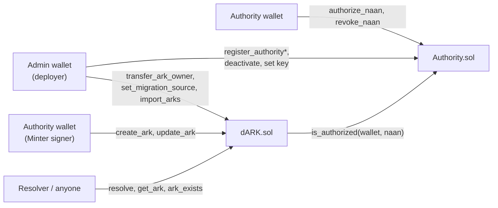
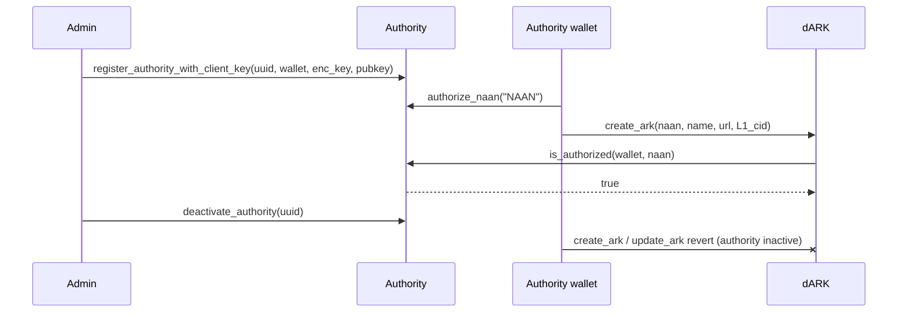

# dARK contracts reference

Three Solidity files in `dARK_dapp/contracts/` (`pragma solidity ^0.8.17`, compiled
with solc 0.8.17). Access control lives in `Authority`; ARK storage lives in `dARK`,
which uses the `IAuthority` interface for authorization and the registry admin address.



## `IAuthority`

```solidity
interface IAuthority {
    function admin() external view returns (address);
    function is_authorized(address wallet, string calldata naan) external view returns (bool);
    function is_active_authority(address wallet) external view returns (bool);
    function get_authority(string calldata uuid) external view
        returns (address wallet, string[] memory naans, bool active);
}
```

## `Authority`

**Model.** One wallet = one authority UUID. The deployer of the contract becomes
`admin` (`constructor`, public `admin`).

```solidity
struct AuthorityData {
    string uuid;
    address wallet;
    bool active;
    string encrypted_private_key;   // AES-256, hex; lets services sign on the authority's behalf
}
```

Storage: `_authorities` (uuid → data), `_wallet_to_uuid`, `_authorized_naans`
(wallet → naan → bool), `_naan_list` (wallet → naan[]), `_client_public_keys`
(uuid → `bytes32` Ed25519 key for HTTP request signing). The blockchain wallet key
and the Ed25519 client key are different things.

Modifiers: `onlyAdmin` (`"Not admin"`), `onlyActiveAuthority`
(`"Not registered"`, `"Authority inactive"`).

| Function | Access | Behavior / reverts |
|---|---|---|
| `register_authority(uuid, wallet, encrypted_private_key)` | admin | `Empty UUID`, `Invalid wallet`, `Empty encrypted key`, `UUID already registered`, `Wallet already registered`; emits `AuthorityRegistered` |
| `register_authority_with_client_key(uuid, wallet, encrypted_private_key, public_key)` | admin | As above plus `Empty client key` (zero key); registers atomically; emits `AuthorityClientKeyChanged` |
| `set_authority_client_key(uuid, public_key)` | admin | `Authority not found`, `Empty client key`; replaces the single current key; emits `AuthorityClientKeyChanged` |
| `deactivate_authority(uuid)` | admin | `Authority not found`; marks inactive; emits `AuthorityDeactivated` |
| `authorize_naan(naan)` | active authority (caller wallet) | `Empty NAAN`, `NAAN already authorized`; emits `NAANAuthorized` |
| `revoke_naan(naan)` | active authority | `NAAN not authorized`; removes from the list; emits `NAANRevoked` |
| `is_authorized(wallet, naan)` | view | `true` only if the wallet's authority is active and the NAAN is authorized |
| `is_active_authority(wallet)` | view | Whether the wallet belongs to an active authority |
| `get_authority(uuid)` | view | `(wallet, naans[], active)`; `Authority not found` |
| `get_authority_auth(uuid)` | view | `(public_key, active)` for DARK2 request authentication |
| `get_uuid_by_wallet(wallet)` | view | `Wallet not registered` |
| `get_authority_key(uuid)` | admin | Returns the encrypted private key; `Authority not found` |

Events: `AuthorityRegistered(uuid indexed, wallet indexed)`,
`AuthorityDeactivated(uuid indexed)`, `NAANAuthorized(wallet indexed, naan)`,
`NAANRevoked(wallet indexed, naan)`, `AuthorityClientKeyChanged(uuid, public_key)`.

> Because the encrypted wallet key is stored on chain, its confidentiality rests on
> the encryption key held by the Admin API and Minter, not on contract access rules.

## `dARK`

Constructor: `dARK(address authority_address)` (non-zero, `Invalid authority address`).

```solidity
struct ARK {
    string name;  string naan;  string url;  string cid;
    address owner;               // authority wallet at creation
    uint256 created_at;  uint256 updated_at;
}
```

An ARK is keyed by `keccak256(abi.encodePacked(naan, "/", name))`. Storage also keeps
`_ark_count`, `_owned_ark_count` (wallet → count) and `migration_source`.

Modifiers: `onlyAuthorizedFor(naan)` (caller must be authorized for the NAAN
according to `Authority.is_authorized`), `onlyARKOwner(naan, name)` (`Not ARK owner`).

| Function | Access | Behavior / reverts |
|---|---|---|
| `create_ark(naan, name, url, cid)` | authorized for `naan` | `Empty name`, `ARK already exists`; stores with `owner = msg.sender` and timestamps; emits `ARKCreated` |
| `update_ark(naan, name, url, cid)` | authorized for `naan` and owner | `Not ARK owner`; updates `url`, `cid`, `updated_at`; emits `ARKUpdated` |
| `transfer_ark_owner(naan, name, expected_owner, new_owner)` | `Authority.admin()` | `Admin only`, `ARK not found`, `Owner changed`, `Invalid new owner`, `Destination inactive`, `Destination NAAN unauthorized`; moves ownership and counters; emits `ARKOwnershipTransferred` |
| `set_migration_source(source)` | `Authority.admin()` | Once, while empty (`Migration already initialized`); `Invalid source`; source must share the same Authority (`Different authority registry`) |
| `import_arks(naans[], names[])` | `Authority.admin()` | `Migration source not configured`, batch of 1–30 (`Invalid batch`), `ARK already exists`; copies ARKs verbatim from the source and emits `ARKCreated` |
| `resolve(naan, name)` | view | Returns `url`; `ARK not found` |
| `get_ark(naan, name)` | view | Full `ARK`; `ARK not found` |
| `ark_exists(naan, name)` | view | `bool` |
| `get_ark_count()`, `get_owned_ark_count(wallet)` | view | Counters |
| `get_authority_contract()` | view | Linked Authority address |

Events: `ARKCreated(naan, name, owner indexed, url, cid)`,
`ARKUpdated(naan, name, url, cid)`,
`ARKOwnershipTransferred(naan, name, previous_owner indexed, new_owner indexed, administrator indexed)`.

For records published through the Minter metadata pipeline, the on-chain `cid`
is the **Level-1 metadata CID** and the Resolver follows it to the original
document. The contract permits an empty CID; direct imports can create such
records, for which metadata views cannot load Level 1.

## Authority lifecycle on chain



Deactivation blocks new writes by the wallet immediately; HTTP key caches in the
Minter and jobs already accepted have separate lifetimes. Ownership of existing
ARKs moves only through `transfer_ark_owner`.
